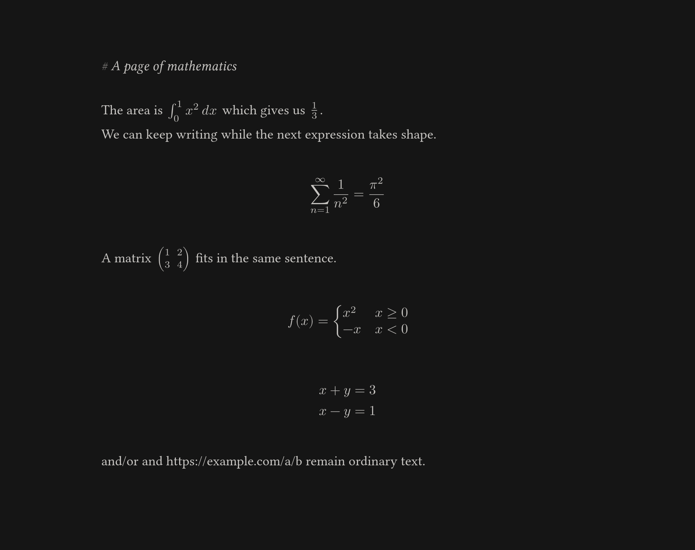

# Mathstral

Mathstral is a native macOS editor for writing prose with inline
math. Type a rough description of a formula between backslashes, such as
`\integral from 0 to infinity of e^-x^2 dx\`, and keep writing. A local model
running in [Ollama](https://ollama.com) turns the description into LaTeX. The
formula is rendered in the background with MiTeX and Typst, so plain writing
never waits for it.



## Requirements

- macOS on Apple Silicon (the only platform tested).
- Rust 1.92 or newer, to build from source.
- [Ollama](https://ollama.com) running on `127.0.0.1:11434`, with the model set in
  [`app/src/config.rs`](app/src/config.rs) (currently `gemma4:e4b`):

  ```sh
  ollama pull gemma4:e4b
  ```

No TeX distribution, browser, JavaScript engine or GPU is needed. Writing, opening
and saving files, and rendering math that is already in a document all work without
Ollama. Only new `\…\` prompts need the model.

## Install

1. Download the release zip and unzip it.
2. Move `Mathstral.app` to `/Applications`.

The app is ad-hoc signed but not notarized. On first launch, right-click
`Mathstral.app` and choose **Open**, or run:

```sh
xattr -dr com.apple.quarantine /Applications/Mathstral.app
```

## Build from source

```sh
sh scripts/build-app.sh          # builds target/Mathstral.app
sh scripts/package.sh            # writes a release zip to dist/
cargo test --release --locked --workspace
```

Renderer benchmarks and their outputs are described in
[docs/RENDERING-SPIKE.md](docs/RENDERING-SPIKE.md).

## Using Mathstral

- Type `\…\` to start a math prompt. An open prompt is tinted; it is dim while the
  model works and turns into a formula when it is ready. If generation fails, the
  prompt stays with a red underline.
- Press **Enter** at the left edge of a formula, or **Backspace** just after it, to
  reopen its prompt and edit it.
- Press **Escape** inside an open prompt to keep it as literal text.
- Markdown styles as you type: headings, bold, italic, `code`, ~~strike~~, links, lists,
  quotes and rules. The markers stay visible. See [docs/EDITOR.md](docs/EDITOR.md#markdown).
- Standard macOS shortcuts work: **⌘N** new, **⌘O** open, **⌘S** save, **⇧⌘S** save
  as, **⌥⌘E** export PDF, **⌘Z** / **⇧⌘Z** undo and redo, **⌘X**, **⌘C**, **⌘V**, **⌘A**.
- Move the window by dragging the top strip or holding **⌘** while dragging.

See [docs/EDITOR.md](docs/EDITOR.md) for the full behavior.

## File format

Files are Markdown-compatible text.

- Inline math is `$…$`. Display math is `$$` on its own lines.
- A formula's source prompt is kept in a hidden comment,
  `<!--mathstral:BASE64URL-->`, so the prompt can be edited later.
- Literal dollar signs in prose are saved as `\$`. Pending prompts are saved as
  `\prompt\` and resume when the file is opened.
- Settings and the last-opened path are stored in `~/Library/Application Support/Mathstral`.

## Project layout

| Path | Contents |
| --- | --- |
| `app/` | The macOS editor (`mathstral`): window, layout, buffer, file handling, Ollama worker |
| `crates/render/` | `mathstral-render`: Typst-based formula rendering, with benchmark binaries |
| `crates/latex/` | `mathstral-latex`: LaTeX to Typst conversion through MiTeX, with a benchmark binary |
| `assets/fonts/` | Bundled fonts and their licenses ([details](assets/fonts/README.md)) |
| `scripts/` | Build and packaging scripts |
| `docs/` | Editor reference, rendering evaluation and original design brief |
| `artifacts/` | Sample screenshots, saved documents and benchmark output |

## Known limitations

- macOS on Apple Silicon only.
- One model request runs at a time. Other prompts wait in a queue.
- The model must be installed in Ollama. Without it, new prompts stay pending until
  Ollama is reachable.
- Imported formulas that have no prompt get a generated description when opened for
  editing. Check the description, especially for complicated formulas.
- The app is ad-hoc signed and not notarized.
- The application binary is about 27 MB, mostly Typst.

## License

Mathstral is licensed under [Apache-2.0](LICENSE).

The bundled fonts are licensed under the SIL Open Font License 1.1 (Libertinus Serif)
and the GUST Font License (New Computer Modern Math); see
[assets/fonts/README.md](assets/fonts/README.md).
